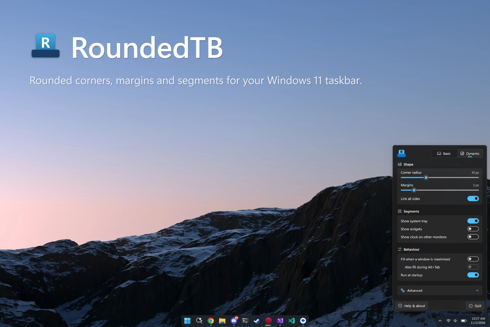

RoundedTB gives the Windows 11 taskbar rounded corners and margins, or splits it into floating segments around your apps and system tray. It lives in the tray, and every setting applies the moment you change it.

## Install

1. Download **[RoundedTB.appinstaller](https://github.com/cryptofyre/RoundedTB/releases/latest/download/RoundedTB.appinstaller)**.
2. Open it and select **Install**.

That's it. RoundedTB updates itself from then on. To remove it, uninstall it like any other app from **Settings → Apps**.

Rather not install anything?

Download the portable zip for your PC from the [latest release](https://github.com/cryptofyre/RoundedTB/releases/latest): `win-x64` for most PCs, or `win-arm64` for Windows on Arm (Snapdragon and similar). Extract the whole `RoundedTB` folder and run `RoundedTB.exe`. The portable version doesn't update itself.

> The RoundedTB on the Microsoft Store is the [original project](https://github.com/RoundedTB/RoundedTB), not this version.

## Features

- **Rounded corners and margins** on every taskbar, secondary monitors included.
- **Dynamic mode** splits the taskbar into segments around your apps and the system tray, and can round the button highlights to match.
- **Fill when maximised** turns the taskbar back to normal while a window is maximised.
- **Settings in a flyout** that opens from the tray icon, right above the taskbar.
- **Removes the Insider build watermark** from the desktop on preview builds of Windows (Advanced → Insider watermark).
- **Runs natively** on both Intel/AMD and Arm PCs.

## Known issues

- **Auto-hide taskbar** isn't supported.
- **Windows 10** isn't supported.
- **Corners aren't antialiased.** This is a Windows limitation.
- **The top of the taskbar isn't rounded.** Raising the top margin helps.
- **Dynamic mode may not cut off the left side on first run** if you've never changed the taskbar alignment. Switch it to Left and back to Center.
- **TranslucentTB** works with the compatibility option enabled, but may flicker when the taskbar updates.

If the taskbar ever looks wrong, quit RoundedTB from its tray icon, or press <kbd>Ctrl</kbd>+<kbd>Shift</kbd>+<kbd>Esc</kbd> and restart Windows Explorer. RoundedTB makes no permanent changes, so that always puts things back.

## Contributing

Found a bug or have an idea? [Open an issue](https://github.com/cryptofyre/RoundedTB/issues/new/choose). To work on RoundedTB yourself, see the [contribution guidelines](.github/CONTRIBUTING.md).

## Credits

RoundedTB was created by [torchgm](https://github.com/torchgm); see the [original project](https://github.com/RoundedTB/RoundedTB). This version builds on the maintenance work in [Gniang/RoundedTB](https://github.com/Gniang/RoundedTB), and the watermark remover is a port of [UWD2](https://github.com/machineonamission/uwd2) by Melody.
